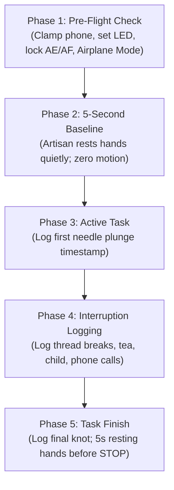

# INSIGHT × SIDBI Time & Motion Study
## Measuring Productivity Among Chikankari Artisans
### Field Standard Operating Procedure (SOP): Video Recording & RepNet AI Repetition Counting

**Prepared for:** M&E Field Officers & Enumerators • The/Nudge Institute • Lucknow, India  
**Document Reference:** `SOP-CHIKAN-REP-2026-V1`

---

## 1. Study Objective & AI Rationale
This pilot tests whether near-vision glasses improve the task completion time, pace, and rhythm of 8 Chikankari artisans in Lucknow performing standardized embroidery tasks (**Motif A: Bakhiya** and **Motif B: Phanda/Murri**).

Video recordings feed into **Google RepNet**, an AI repetition-counting neural network, to objectively measure:
- **Movement repetition rate** (stitches / minute)
- **Active stitching share vs. pauses / interruptions**
- **Cycle time consistency** (rhythm stability across session quintiles)

> [!IMPORTANT]
> Hand embroidery involves delicate, millimeter-scale needle motions. Handheld camera wobble, poor lighting, or far-away framing cause the AI model to lose track of needle cycles. **Strict adherence to this SOP is mandatory to ensure AI data validity.**

---

## 2. Mandatory Equipment Checklist (Zero-Handheld Filming)

| # | Item | Field Requirement | Mandatory Purpose |
| :---: | :--- | :--- | :--- |
| **1** | **Smartphone Camera** | 1080p @ 30 FPS • Clean lens • Airplane Mode enabled | High-definition capture; 30 FPS matches AI temporal strides. |
| **2** | **Flexible Gooseneck Clamp / Tripod** | Clamped to wooden *adda* frame or heavy table | **MANDATORY**: Zero camera shake. Handheld filming invalidates AI self-similarity matrices. |
| **3** | **Directional Clip-On LED Light** | 400 lumens, 4500–5000K daylight, battery/USB | Eliminates shadows in dim artisan homes; illuminates fabric entry point. |
| **4** | **Observer Logging Tablet / Sheet** | Digital timer & printed session log sheet | Provides independent ground-truth verification of start/stop and interruptions. |
| **5** | **Pre-traced Standard Motifs** | Motif A (Bakhiya) & Motif B (Phanda) on identical fabric | Standardized task complexity across glasses / no-glasses visits. |

---

## 3. Camera Placement, Geometry & Framing Specifications

```
                       Camera Placement Geometry (45° Angle)
                       
              [ Smartphone on Gooseneck Clamp ]
                         \
                          \  Distance: 35–45 cm
                           \  Viewing Angle: 45°–60°
                            ▼
               ┌─────────────────────────────┐
               │    Wooden Embroidery Hoop   │  <-- Hoop fills 65%–75%
               │   [ Needle Entry & Hands ]  │      of video frame
               └─────────────────────────────┘
```

1. **Distance from Hoop**: **35 to 45 cm** (Tight Framing). Do NOT place the camera across the room. Hands and the wooden hoop must occupy **65% to 75%** of the frame.
2. **Viewing Angle**: **$45^\circ\text{ to }60^\circ$ Top-Down Angle**. Must see both the needle piercing the upper fabric AND the hand pulling thread underneath.
3. **Orientation**: **Horizontal (Landscape)** preferred. If vertical, ensure the hoop is centered in the middle third.
4. **Focus & Exposure (AE/AF Lock)**: **Tap and hold** the phone screen on the needle entry point until **"AE/AF LOCK"** appears. This stops the camera from hunting for focus as hands move.

---

## 4. Standard 5-Phase Recording Procedure



### Detailed Phase Protocol:
- **Phase 1: Pre-Flight Check**: Clamp phone securely. Turn on task LED light. Clean lens. Confirm battery $>50\%$ and storage $>5\text{ GB}$. Put phone on **Airplane Mode** so incoming calls don't stop recording.
- **Phase 2: 5-Second Stationary Baseline**: Press **RECORD**. Ask artisan to sit quietly with hands resting on the frame for **5 seconds**. This gives RepNet a clean baseline of the static fabric and hoop.
- **Phase 3: Active Stitching**: Signal: *"Aap shuru kar sakti hain"*. Record the exact video timestamp of the **FIRST needle entry** on your log sheet.
- **Phase 4: Interruption Logging**: If the artisan pauses for non-task reasons (re-threading, tea, child, phone call), log the exact start and end seconds under Interruption Events.
- **Phase 5: Task Completion**: When the artisan ties the final knot, log the timestamp. Keep recording for **5 seconds of resting hands** before pressing STOP. Save file as: `[ArtisanID]_[Visit]_[Glasses/NoGlasses]_[MotifA/B].mp4`.

---

## 5. Pilot Motif & RepNet Calibration Reference

| Study Motif | Primary Stitch Style | Kinematic Movement Ratio | In-App Profile Setting |
| :--- | :--- | :--- | :--- |
| **Motif A (Standard)** | **Bakhiya** (Shadow Work / Double Backstitch) | 2 optical movements = 1 completed stitch | `Motif A: Bakhiya (÷ 2.0)` |
| **Motif B (Standard)** | **Phanda / Murri** (French Knots / Grain Knots) | 3 optical movements = 1 completed knot | `Motif B: Phanda (÷ 3.0)` |
| **Outline Work** | **Tepchi** (Running Stitch) | 1 optical movement = 1 completed stitch | `Tepchi: Running (÷ 1.0)` |

---

## 6. Observer Session Log Sheet (Printable Field Form)

```text
========================================================================================
                      INSIGHT × SIDBI CHIKANKARI PILOT STUDY LOG SHEET
========================================================================================
Artisan ID: _________________________         Visit:  [ ] Visit 1     [ ] Visit 2
Study Condition:  [ ] With Near-Vision Glasses         [ ] Without Glasses (Control)
Task Motif:       [ ] Motif A (Bakhiya)               [ ] Motif B (Phanda)
Session Date: _______________________         Enumerator Name: ________________________
Camera Phone Model: _________________         Video File Name: ________________________
----------------------------------------------------------------------------------------
Video Start Time: ____________                First Needle Plunge (Time): ____________
Task Finish (Final Knot): ____________        Video Stop Time: ____________
Total Active Duration: ____________           Total Hand-Counted Stitches: ____________
----------------------------------------------------------------------------------------
INTERRUPTION EVENTS LOG (Pauses unrelated to active stitching):
  • Interruption 1: Start _______  End _______  Reason: ________________________________
  • Interruption 2: Start _______  End _______  Reason: ________________________________
  • Thread Breaks / Re-threading Count: [   ] times
----------------------------------------------------------------------------------------
ARTISAN COMFORT & STRAIN (1 = Very Low, 5 = Severe):
  • Eye Strain Rating:  1 [ ]   2 [ ]   3 [ ]   4 [ ]   5 [ ]
  • Visual Ease Rating: 1 [ ]   2 [ ]   3 [ ]   4 [ ]   5 [ ]
  • Physical Neck/Back Fatigue: 1 [ ]   2 [ ]   3 [ ]   4 [ ]   5 [ ]
----------------------------------------------------------------------------------------
Enumerator Signature: _______________________   Consent Verified: [ ] YES
========================================================================================
```

---

## 7. Field Troubleshooting Quick-Guide

1. **What if the artisan repositions the hoop?**
   - That is completely normal. The app's **Anti-Shake Stabilization** and **Smart Crop** automatically compensate for small hoop angle changes. Note the timestamp of large readjustments as a short pause.
2. **What if thread breaks during work?**
   - Do NOT stop the video. Let the artisan re-thread. The AI will automatically classify the re-threading interval as an **inactive pause period**, keeping the active stitch rate clean!
3. **What if the home is dark or power is out?**
   - Clip the portable battery-operated LED light to the top of the embroidery frame pointing downwards. Do NOT record without directional lighting.

